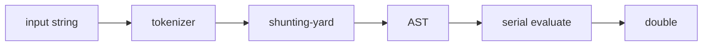

# Architecture (Phase 2)

```
line of text
    -> REPL command  OR  expression string
        -> tokenizer (positions)
        -> shunting-yard parser -> AST
        -> serial evaluator (EvalContext: variables, angle mode, ExecOptions)
        -> printed double
```



`ExecOptions` is stored on the context but **does not parallelize evaluation yet** (Phase 9). Trig currently calls `std::sin` and friends (Phase 3 replaces that with Taylor/CORDIC).
