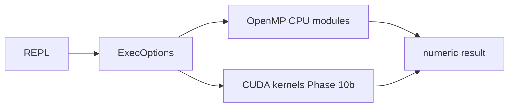

# Architecture (Phase 1)

```
user input
    -> REPL (commands only in Phase 1)
        -> ExecOptions (mode, thread count, cutoff)
        -> modules (later: parser, eval, functions, calculus, linalg, solvers, bignum, stats)
        -> optional CUDA kernels (Phase 10b, same math, different device)
    -> benchmark CSV (Phase 10) -> Drive -> plots (Phase 10c)
```



There is **no global mutable config**. `ExecOptions` is passed into functions. Serial and parallel implementations share the same headers.

Phase 1 only compiles `libpsc` (error, exec, machine_info), `psc` REPL, `psc_machine_info`, `psc_bench` stub, and `psc_tests`.
